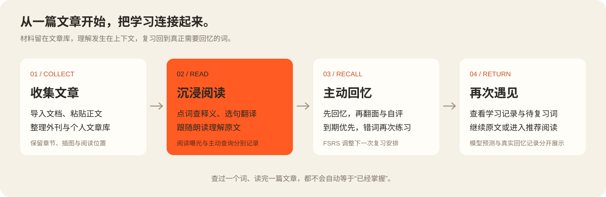
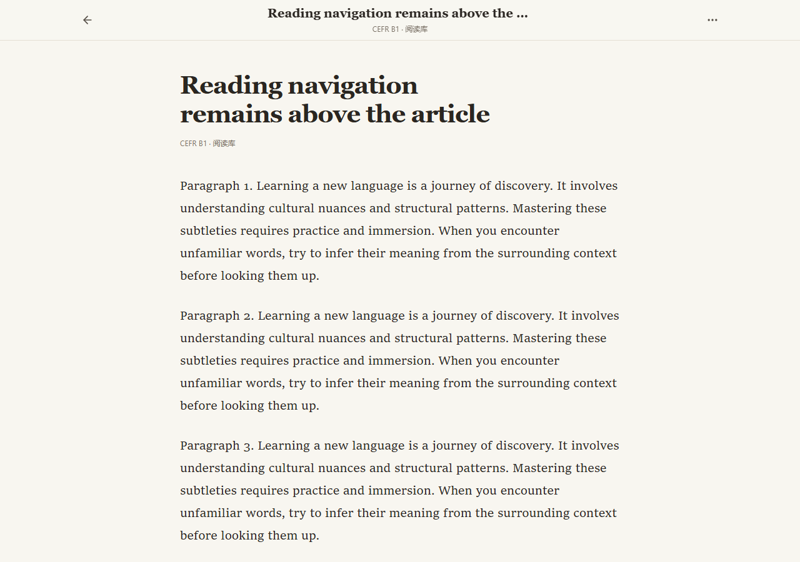
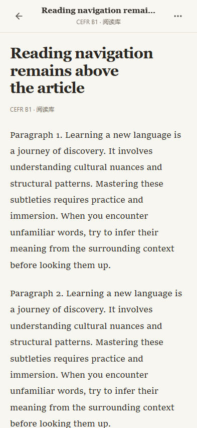
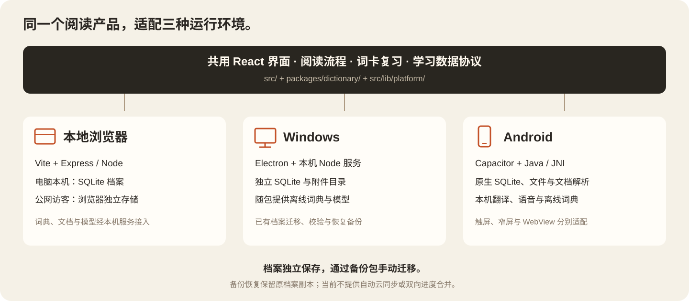

<p align="center">
  
</p>

# ReadAge

**围绕文章展开的本地阅读与语言学习应用。** 把文章库、上下文查词、选句翻译、朗读和间隔复习连接起来，让一次阅读留下可以继续使用的学习记录。

[下载安装包](https://github.com/time-and-star/readage/releases/latest) · [快速开始](#快速开始) · [功能与学习流程](#功能与学习流程) · [模型声明](#大模型与语音模型声明) · [三端架构](#三端架构) · [开发文档](#开发文档) · [Apache 2.0](LICENSE)

ReadAge 以英语学习为主，也提供法语、日语阅读及对应词典和语音接入。应用采用暖纸色阅读界面和橙色启动画面；浏览器、Windows 与 Android 共用界面和学习规则，并通过各自的平台实现处理文件、存储和本机模型。

## 功能与学习流程



| 你想做什么 | ReadAge 如何帮助你 |
| --- | --- |
| 把材料放在一起 | 粘贴文章，导入 EPUB、PDF、DOCX 等文档，按书籍章节、期刊目录或个人文章整理材料；保留图片、附件和阅读断点。 |
| 读懂眼前这段话 | 点词查看释义、词形和来源；选中句子后按需翻译；使用朗读和随音频移动的词框辅助阅读。翻译与本机朗读需要对应资源。 |
| 把遇到的词带进复习 | 阅读查词和主动词表导入共用词卡队列；先复习到期词，再按每天设置安排新词。可暂停、恢复或移出词卡，保留历史。 |
| 确认自己能否回忆 | 先回忆，再翻面和自评；FSRS 根据正式回忆记录安排后续复习，忘记的词在本轮再次出现。 |
| 接着上次读下去 | 每篇文章独立保存进度；外刊按本期顺序、书籍按章节或页序继续；推荐阅读使用单独入口，不打断文章库的阅读顺序。 |
| 保存自己的积累 | 本地档案保存文章、学习记录与偏好；支持完整 ZIP 备份及兼容 JSON 恢复，恢复前保留原档案副本。 |

### 阅读界面

下图来自当前源码的真实阅读组件，使用隔离的示例文章生成。它展示阅读排版与窄屏适配，不代表 Windows 安装版或 Android 真机验收已经完成。

<p align="center">
  
</p>

<p align="center">
  
</p>

### 查词、词卡与记忆

**ReadAge 自编词典是项目的核心内容之一。** 当前发布快照包含 **17,974 个词条、30,538 个义项和 35,138 条义项例句**；完整内容经本地词典适配器进入阅读查词、搜索、词卡详解与导出。

除了中英释义，词条还保留原有的词源与构词、形近易混词、近反义词辨析、常见错误、语境与长难句、即时检测和参考来源等模块。词卡详解优先展开自编内容；普通查询继续尊重用户设置的词典顺序。各词典的释义和来源分别呈现，不混成一个没有出处的结果。

本轮对 `promote`、`compulsory` 的文字修订、全库结构核对与尚待编辑的样例，见 [自编词典检查记录](docs/authored-dictionary-review-2026-10-16.md)。统计与全库结构通过不等于所有释义和例句已经逐条完成语义终审。

- **在上下文中查词。** 词卡保留原句、来源和展开内容，支持多个本地词典；法语和日语使用各自的语言标识与词形处理，避免写入错误的英语学习证据。
- **自己决定复习范围。** 词表可通过文件或粘贴导入，先预览新增、已有、重复与无效项。再次导入不会重置已有记忆；导入动作本身也不算学习成功。
- **把阅读曝光和回忆分开。** 看到一个词、查过一个词、成功回忆一个词分别记录。未查询不等于已掌握，读完文章也不会把整个词库标为已复习。
- **看懂模型给出的安排。** 记忆曲线展示 FSRS 的预测与已有回忆记录，支持不同时间范围；预测值属于模型估计，不是实测成绩。

### 本机翻译与朗读

选句翻译可接入本机 **Hy-MT2**，朗读可使用本机 **Kokoro**。英语提供英音 / 美音选择，并有法语和日语语音接入。音色、语速、停止和播放位置由共用界面控制；Android 使用原生推理与音频队列。

本机模型和音色属于独立资源，源码克隆不包含全部运行资源。Windows 完整安装包与 Android 完整 APK 按各端构建清单装入离线资源；实际声音来源、速度和听感需要在交付设备上分别验证。

配置与资源说明：[本机翻译](docs/local-translation.md) · [朗读与 TTS](docs/tts.md) · [法语词典](docs/dictionary-french.md) · [日语词典](docs/dictionary-japanese.md)

## 大模型与语音模型声明

ReadAge 使用第三方模型提供翻译和语音能力，感谢相应模型作者与转换、推理项目的贡献。模型权重、音色及推理组件保留各自的版权和许可，项目的 Apache 2.0 许可证仅适用于 ReadAge 自有源码。

| 模型 / 服务 | 用途与平台 | 来源与许可 |
| --- | --- | --- |
| 腾讯 Hy-MT2-1.8B | 本机选句翻译；浏览器 / Windows 使用 AngelSlim 1.25bit GGUF，Android 使用官方 Q4_K_M GGUF | 腾讯 / AngelSlim；模型 Apache-2.0，llama.cpp 运行器 MIT |
| Kokoro-82M v1.0 | 浏览器 / Windows 的英、美、法、日语朗读；Android 的英、美、法语朗读 | hexgrad；ONNX 转换由 onnx-community / Sherpa ONNX 提供，模型 Apache-2.0 |
| Supertonic 3 | Android 日语朗读，使用 Sherpa ONNX int8 转换 | Supertone；模型 **BigScience Open RAIL-M**，推理源码 MIT，模型适用原许可的使用限制 |
| DeepSeek、阶跃星辰、Google Gemini | 源码保留可选在线翻译、文本或实时语音接口；是否可用取决于功能开关、配置和服务状态 | 使用各服务商的服务条款；发行包不包含这些在线模型的权重 |

Windows / Android 当前离线发行配置关闭在线 AI；本机翻译文本和本机合成语音的文本由设备上的模型处理。发音前端 eSpeak NG、ONNX Runtime 等运行组件另有 GPL-3.0、MIT 等许可，不能用模型许可证替代。

具体版本、上游链接、量化与修改说明、三端差异及随包许可位置见 **[模型来源与许可声明](docs/ai-models.md)**。模型译文和合成语音可能有错误；使用第三方模型不表示相关作者或服务商为 ReadAge 提供认证或背书。

## 下载与平台

前往 [GitHub Releases](https://github.com/time-and-star/readage/releases) 下载对应版本，以每次 Release 的资产清单、校验和及验收记录为准。

| 平台 | 使用方式 | 需要了解的条件 |
| --- | --- | --- |
| Windows x64 | 安装 `ReadAge-<版本>-windows-x64-setup.exe` | 完整离线包提供词典、模型及运行组件；本机翻译运行器要求 CPU 支持 AVX2，无需另装 Node 或 Python。 |
| Android 12+ | 安装 Release 中的 `.apk` | 当前工程包含 arm64-v8a / x86_64，离线资源使包体积较大；当前分发包使用既有调试签名，升级须保持签名一致。 |
| 本地浏览器 | 从源码启动本机服务 | 需要 Node.js 22.13 或更新版本；浏览器访问本机地址，文件和模型由本机服务处理。 |
| Chrome / Edge 插件 | 按 [插件说明](extension/README.md) 加载 | 在网页选词查词，并连接正在运行的本机 ReadAge。 |

安装、源码和设备状态分开记录。**下载到新包不表示现有设备已经更新；构建成功也不表示真机上的所有功能已通过。** 当前平台差异、暂缓能力和逐项结果见 [跨端交付说明](docs/platform-parity.md) 与 [用户功能验收](docs/user-feature-acceptance.md)。

## 快速开始

### 1. 安装并启动本地浏览器版

```bash
git clone https://github.com/time-and-star/readage.git
cd readage
npm install
npm run start:local
```

打开 **http://localhost:3000**。Windows 也可双击项目中的 `start-local.cmd`。使用期间保持本机服务运行。

源码仓库不包含个人学习档案、外刊原文件，以及体积较大的第三方词典和模型。完整离线能力需要按对应文档准备资源；缺少资源时，以界面中的明确提示为准。

### 2. 按需要启用服务

`.env.example` 列出可用配置。复制为本机的 `.env.local` 后，只填写需要使用的项目：

```bash
cp .env.example .env.local
```

- 本机句子翻译与朗读按 [翻译配置](docs/local-translation.md)、[语音配置](docs/tts.md) 准备资源。
- 在线 AI 接口是可选接入，使用有效凭据并服从当前界面的功能开关；当前界面中的解释与讨论保持关闭。
- Windows / Android 的离线发行配置关闭在线 AI。Windows 可由用户主动更新已配置的外刊；Android 当前不开放联网更新入口。已有材料可继续离线阅读。

供应商密钥仅保存在本机环境或服务端配置中。公网部署与个人本机启动采用不同的数据和访问策略，见 [浏览器运行与部署](docs/web-deployment.md)。

### 3. 开始第一轮阅读

1. 在文章库导入自己的材料，或粘贴一篇文章。
2. 进入正文，点词查义、选句翻译，按需要开启朗读。
3. 返回学习概览，查看记录，进入词卡学习或继续阅读。
4. 定期从“数据与备份”导出档案。

## 三端架构



| 层次 | 主要实现 |
| --- | --- |
| 界面与学习流程 | React 19、TypeScript、Vite、Tailwind CSS；阅读、词卡、推荐与记忆模型位于 `src/`。 |
| 浏览器 / Windows 本机服务 | Express、Node SQLite、文档解析、词典、翻译和朗读服务；Windows 通过 Electron 提供独立应用窗口。 |
| Android | Capacitor、Java 原生插件与 JNI；分别实现本地数据库、文档、词典、外刊、翻译和语音。 |
| 学习安排 | 共用 FSRS 记忆与复习逻辑，数据协议由平台适配器对接各自存储。 |

应用标识和既有数据目录保留兼容值。产品展示名称统一为 **ReadAge**，代码或路径中的 `readge` 不应通过批量重命名改变既有档案位置。

### 学习数据与备份

| 环境 | 档案保存位置与行为 |
| --- | --- |
| 电脑本机浏览器 | 本机模式使用 `local-data/library/learning.sqlite`；首次迁移保留浏览器原记录和快照，不同来源档案分别保留。 |
| Windows 应用 | 用户目录 `%APPDATA%\readge\workspace` 中的 SQLite 与附件目录；升级不主动清空个人档案。 |
| Android 应用 | 应用私有 SQLite 与文件目录，通过原生适配器读写。 |
| 公网访客 | 默认关闭电脑档案接口，每位访客使用自己的浏览器存储；清站点数据或换浏览器前应先备份。 |

三端各有自己的档案。当前迁移包属于手动恢复或替换，**不提供自动云同步或双向学习进度合并**。完整 ZIP 备份携带记录与引用的 PDF / 图片，恢复前核验完整性并保留原档案副本；词典和模型单独管理。

## 开发与验证

```bash
npm run lint
npm run check:extension
npm run check:dictionary
npm test
npm run desktop:test
npm run platforms:check
```

Android 另有数据库、文件、文档、词典、外刊、语音及选句回调的 Java 主机测试。隔离浏览器与主机测试覆盖其声明的范围，不替代正式模型听感、安装状态或真机行为验收。

| 构建目标 | 命令 | 输出 |
| --- | --- | --- |
| 网页生产版 | `npm run build` | `dist/` |
| Windows 安装包 | `npm run desktop:package` | `build/desktop/` |
| Android APK | `npm run android:apk` | `android/app/build/outputs/apk/debug/` |
| 浏览器插件 | `npm run build:extension` | `extension/dist/` 与可下载 ZIP |

Windows 与网页构建共用 `dist/`，完整交付先打 Windows 包，再构建网页。Android 需要从共用源码构建、同步 Capacitor 资源并生成 APK。发布时使用 `npm run platforms:check -- --strict` 核对快照、同步记录和包哈希。

项目默认先完成源码与相关验证，待用户检测或明确要求发布后集中编译；协作规则见 [AGENTS.md](AGENTS.md)。

## 开发文档

| 文档 | 内容 |
| --- | --- |
| [产品与技术设计](DESIGN.md) | 页面组织、阅读与学习流程 |
| [跨端修改与交付](docs/platform-parity.md) | 三端对应关系、构建快照和交付状态 |
| [用户功能逐项验收](docs/user-feature-acceptance.md) | 入口、操作、可观察结果和实际验收范围 |
| [Windows 应用](desktop/README.md) | 离线资源、档案迁移、安装与运行 |
| [Windows / Android 本地实现](docs/desktop-android-local.md) | 平台适配、原生能力与真实差异 |
| [Android 验收记录](docs/android-acceptance.md) | 原生功能与设备验证范围 |
| [词典接口与来源](docs/dictionary-interface-v1.md) | 多源查询、契约和词典服务 |
| [翻译](docs/local-translation.md) / [朗读](docs/tts.md) | 本机模型、语音与故障排查 |
| [模型来源与许可声明](docs/ai-models.md) | 大模型与语音模型的用途、来源、版本、许可及三端对应 |
| [浏览器插件](extension/README.md) | 安装、选词查词与本地服务连接 |

## 许可证与第三方资源

ReadAge 自有源码采用 **[Apache License 2.0](LICENSE)**，项目归属说明见 [NOTICE](NOTICE)。

第三方库、词典、模型、音色和外刊内容保留各自原有许可与版权声明；本仓库的许可证不替代这些资源的授权。发行包保留所需的第三方许可、通知和随包源码。已有声明见 [模型来源与许可声明](docs/ai-models.md)、[ECDICT 与词典通知](vendor/nextword-local-dictionary/THIRD_PARTY_NOTICES.md)、[WordNet 许可](vendor/wordnet/LICENSE.txt) 及 Android / Windows 的资源清单。请只导入或分发你有权使用的文章和文档。
