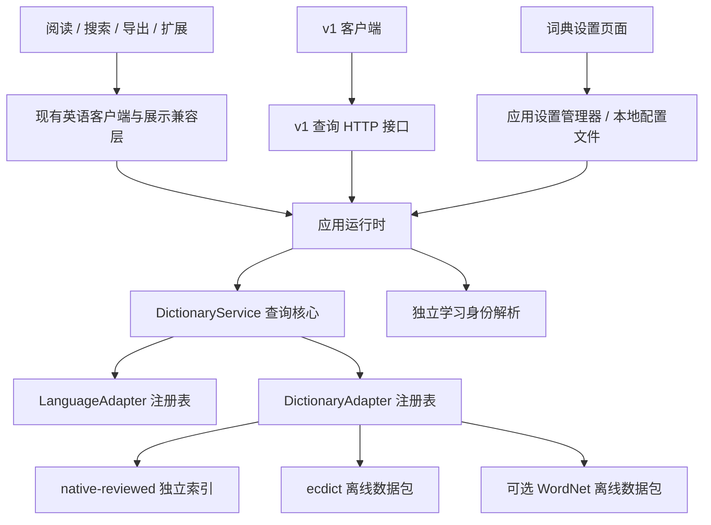

# 通用词典接口 v1

本模块位于 `packages/dictionary`。查询核心、公共契约和浏览器客户端不依赖 React、应用页面类型或 Node 文件系统。英语编辑模型也移入模块的 `compat` 目录；原有 `src/types.ts` 与 `server/dictionary/model.ts` 继续转发原名称。

当前接入 `native-reviewed`、`ecdict`、可选 WordNet 和用户导入的 MDX，保持现有英语页面、教学和导出模型。学习概况底部的“设置与工具 → 词典设置”提供紧凑来源卡片、拖动排序和浏览器 MDX 文件导入。MDX 原文经安全节点转换后展示，不加载词库脚本、样式、图片或音频；没有新增真实日语分析或词库。管理和安装属于应用层，公共 v1 查询契约保持不变。

## readge 自编词典接入

阅读查词、全局搜索、复习词卡及词卡内继续查词共用 `fetchWordCard` 和版本缓存。单词与短语都先查询已启用词典，未收录时才提示翻译。导出、教学兼容层及浏览器扩展通过兼容 API 访问同一运行时。将 `native-reviewed` 启用、排在首位并设为默认后，所有这些入口优先返回完整 readge 自编词库；其他已启用词典继续提供独立来源内容。保留该来源 ID 是为了沿用已保存的来源设置，不代表仅加载审核样本。

词典设置保存后，当前阅读、搜索、复习和嵌套查词立即重新查询；刷新不额外记录查词证据。既有学习身份、存储键及复习安排保持不变。2026-10-08 从桌面 `词典/readage` 的当前发布脚本装配得到 **17,974 个词条、30,538 个义项、0 个待编占位词条**。这是实际自编词库，与阅读应用的 `curated-50.jsonl` 编辑实验样本不同。

`npm run dictionary:import-readage -- "<readge 项目目录>"` 按该目录 `index.html` 引用顺序装配数据，执行原项目数据校验；不扫描备份或草稿脚本。输出位于 `data/dictionary/readage`，包括完整原数据的压缩块、字节索引与数量/哈希清单。服务器按词条读取，词库不进入网页包。更新源词库后重新导入并重启服务。

`ReadAgeAuthoredAdapter` 同时提供中性义项结构、既有英语展示投影和 `readage.authored.v1` 原数据扩展。兼容接口的各来源 `readageContent` 保留完整原词条：中文详解、例句分析、搭配例句、家族词、词源、易混辨析、纠错、语境、练习及参考来源。完整词卡展示这些模块，练习可直接选择答案。原文中的教学 HTML 通过已有安全节点解析器展示。原词库没有阅读应用的审核字段，因此接入不会虚构 `reviewed` 状态；发布例句标注为 `dictionary-source`。



## 稳定契约与导入边界

| 接口 / 文件 | 职责 |
| --- | --- |
| `contracts.ts` | 全部公开 v1 类型、协议与数据结构版本 |
| `core.ts` / `index.ts` | 语言与词典注册、来源顺序、查询、批量、详情和状态 |
| `languages/english.ts` | 当前英语文本归一化、分词及查询候选；原阅读工具保留转发入口 |
| `client.ts` | 浏览器与扩展 HTTP 客户端；自动分批，每批最多 50 条 |
| `cache.ts` | 目录校验、60 秒有效期、离线目录快照和版本缓存键 |
| `server/ecdict.ts` | ECDICT 数据包适配器 |
| `server/nativeReviewed.ts` | 已审核 JSONL 与清单适配器；独立索引 |
| `server/wordnet.ts` | 可选 WordNet 3.1 官方离线词库适配器；只实现中立契约 |
| `server/mdxAdapter.ts` | 已导入 MDX 的索引、校验和原文词条读取 |
| `server/englishEntry.ts` | 英语编辑记录到中立词条的转换 |
| `compat/englishTypes.ts` / `englishModel.ts` | 既有英语编辑及展示格式 |
| `server/dictionary/runtime.ts` | 已安装来源注册、配置快照切换、独立英语学习身份解析 |
| `server/dictionary/settings.ts` / `settingsRoutes.ts` | 应用设置校验、修订冲突、原子持久化和管理 HTTP 接口 |
| `server/dictionary/imports.ts` / `importRoutes.ts` | 浏览器 MDX 上传、受限检查、持久安装和注册 |
| `server/dictionary/compatibility.ts` | 选取优先来源，并为旧英语视图补充字段、记录字段来源 |

浏览器代码只导入 `index.ts`、`contracts.ts`、`client.ts`、`cache.ts`、语言工具或纯兼容模型。服务端适配器必须通过 `server/*` 明确导入，不从公共入口重导出。词典文件仅由服务端读取。

### LanguageAdapter

声明 `language`（BCP 47）、`adapterVersion`、`capabilities`，实现 `normalize`，按需实现 `segment` 与 `candidates`。分词偏移使用 JavaScript UTF-16 字符偏移，与现有阅读代码一致。能力状态为 `supported` / `unsupported`，未声明的分析能力不能由调用方推断。

英语适配器使用固定版本的 `wink-nlp@2.4.0` 和 `wink-eng-lite-web-model@1.8.1`，只运行分词管线。`englishTokenizer.ts` 将语言分析结果投影回原文的 UTF-16 位置，不使用库的重建文本替换原文；保留前后空白、Unicode、标点和软连字符。缩写如 `can't` 和所有格保留完整点击范围，普通连字符、破折号、斜杠及空白分隔的词分别点击。显式指定的复合词仍可作为完整学习单位匹配，但不扩大正文单词的点击范围。分词结果按 128 段 / 256,000 字符限制缓存，返回副本，模型按首次使用初始化并复用。正文、词卡文本、点击和手机选词共用该分词器。

`englishSurface.ts` 单独提供查词排版归一化和英语词面校验，保留重音字母、数字混合词和点式缩写；只需要归一化的客户端不加载语言模型。词典来源、学习身份及学习存储格式保持原有职责；不把 winkNLP 推测的词元作为学习 ID，不迁移或清理复习记录。适配器版本包含引擎、模型和阅读规则版本，进入现有目录与查词缓存版本。ECDICT 验证词形后，核心可让其他已选来源查询已确认的词头。若未注册语言适配器，核心保留输入的完整 Unicode 文本，并传入 `exactOnly: true`；词典适配器须执行精确查询，不能自行应用英语归一化或词干规则。导入原文已经丢失的空格不会被分词器凭猜测补回；词典是否收录仍由各来源独立决定。

### DictionaryAdapter

声明 `metadata`，实现 `lookup` 和 `getEntry`，可选实现 `getStatus`、`getResource`。来源信息包括稳定词典 ID、语言、释义语言、内容版本、数据结构版本、适配器版本及能力。

`lookup` 接收候选列表、原查询、语言、上下文、指定词典和偏好释义语言，以及可选 `AbortSignal`。候选类型为 `exact`、`normalized`、已确认的 `inflection`。返回多个 `AdapterMatch`；每个匹配包含完整词条和匹配类型。未收录返回空数组；读取、解析或初始化故障抛出异常，由核心转成 `unavailable`。不要把故障转成空数组。

适配器自行维护格式解析、索引、原始记录和资源。`getEntry` 的 ID 为来源内稳定 ID，不应依赖义项数组位置。`getResource` 返回 MIME 类型与字节；当前仅保留该接口，没有资源 HTTP 路由。原版内容使用 `kind: 'original'`、`mediaType`、`content` 和资源 ID。MDX 通过该既有联合类型返回原文；网页完整词卡使用安全节点白名单展示 HTML 文字和基本格式，小弹窗与扩展使用纯文本投影，浏览器不直接执行原文 HTML。

### DictionaryService

`createDictionaryService(config)` 提供 `registerLanguage`、`registerDictionary`、`lookup`、`lookupMany`、`getEntry`、`listSources`。重复注册抛出异常。配置对象被复制，运行中修改原对象不会改变核心服务。应用设置管理器保存新配置时替换查询核心快照，复用已安装适配器和独立身份解析器；已经挂载的服务门面继续可用，不必重启应用。

查询请求：

```ts
{
  text: 'running',
  language: 'en',
  context: 'She is running a shop.',
  dictionaryIds: ['native-reviewed', 'ecdict'], // 可选：只查询这些已启用来源
  preferredDefinitionLanguages: ['zh', 'en'], // 可选：传递给适配器的偏好，不过滤原词条
}
```

每个来源分别返回结果，顺序由服务配置决定；核心不会合并不同词典的义项。`defaultSource` 用于目录展示默认来源，`sourceOrder` 明确决定查询和展示的优先级。未指定来源时查询全部已启用且支持请求语言的来源；指定未知或禁用来源为无效请求。

| 状态 | 含义 |
| --- | --- |
| `found` | 至少一个来源找到词条；其他来源的故障仍保留在 `sources` |
| `not_found` | 已查询来源均未收录，或没有支持该语言的已启用来源 |
| `unavailable` | 没有找到词条，且至少一个相关来源读取失败；不能判定为未收录 |
| `invalid_request` | 文本、语言或查询选项不合法，或来源未知 / 已禁用 |

`lookupMany` 每批最多 50 条；结果包括重复输入、未收录和无效请求，严格保持输入顺序。取消请求拒绝 Promise，保留 `AbortError` 或传入的取消原因；取消不是未收录。核心即使遇到忽略信号的适配器也能停止等待，实际后台工作是否停止由适配器决定。

词条包含 `dictionaryId`、`entryId`、`contentVersion`、`schemaVersion`、词头、语言、来源、读音、词形、可选等级及内容。结构化义项的定义、翻译和例句均携带语言标识；CEFR 通过 `levels: [{ system: 'CEFR', value: 'B2' }]` 表达。英语历史编辑记录使用可忽略的命名空间扩展 `readage.english.v2`，核心不识别该扩展。

协议版本为 `dictionary-api.v1`，中立词条数据结构为 `dictionary-entry.v1`。既有英语编辑结构继续使用 `dictionary.v2`，三者用途不同。v1 中新增可选字段兼容；删除字段、修改语义或改变必填项需要新的主版本和 HTTP 路径。适配器版本独立记录解析逻辑变化；内容版本标识数据快照。

## 应用数据源与配置

未保存偏好时默认启用全部已安装来源，顺序先 `native-reviewed,ecdict`，其他来源追加在后，默认来源为 `native-reviewed`。应用启动时若默认目录 `data/dictionary/imported/wordnet-3.1` 含 `manifest.json`，会自动注册 WordNet；`DICTIONARY_WORDNET_DIR` 可明确指定其他位置。首次配置的环境变量示例：

```dotenv
DICTIONARY_SOURCES=native-reviewed,ecdict
DICTIONARY_SOURCE_ORDER=native-reviewed,ecdict
DICTIONARY_DEFAULT_SOURCE=native-reviewed
```

禁用旧源展示可设置 `DICTIONARY_SOURCES=native-reviewed`。默认来源必须已启用，未知配置 ID 会在启动时拒绝。已保存偏好优先于上述启动偏好；环境变量不会覆盖用户已经保存的启用、顺序或默认来源。程序接入新插件时，可以向 `createDictionaryRuntime` 传入 `additionalLanguages` / `additionalDictionaries`，无需修改核心契约。

### 词典设置与保存

页面路径为 `/settings/dictionaries`，入口放在 `/learning` 学习概况最下方。已安装来源采用紧凑卡片，语言、来源和版本等信息按需展开；可启停、拖动排序，在拖动手柄上用上下方向键排序，并指定默认来源。拖动标题或手柄时卡片跟随指针，相邻卡片实时让位，松手后落位；Escape、指针取消或窗口失焦会恢复本次拖动前的顺序，不写入设置。启用开关和详情区不触发拖动，并尊重系统减少动画偏好。

排序松手、键盘排序、启停和默认来源调整均自动保存，没有常驻的保存、还原或未保存提示。拖动预览不发写入请求；连续更新串行使用最近确认的 revision，期间保留最新选择，成功后更新词典目录和查词缓存。保存失败保留当前选择并提供重试；409 冲突要求重新加载，避免覆盖其他窗口的设置。离开设置页只解除界面订阅，已发起的小型保存请求继续完成。损坏设置文件仍需用户调整设置或点击警告中的修复入口后才替换。至少保留一个已启用来源，默认来源必须已启用。顺序决定各家词卡的排列，默认来源与顺序分别设置。不可用来源保留在目录中，不会被当成已卸载。

应用设置文件默认是 `local-data/dictionary/settings.json`，可通过 `DICTIONARY_SETTINGS_FILE` 指定位置。设置是当前服务实例的配置，使用同一服务的浏览器共享这份选择；学习记录仍保存在各自浏览器，设置文件不包含词汇记忆或复习状态。`createDictionaryRuntime({ settingsFile })` 显式启用持久化；未提供路径的程序测试实例仅在内存中保存。

保存先校验并准备配置，随后在目标文件同目录写临时文件、同步并原子替换，成功后立即切换查询配置。保存失败保留当前配置。重启读取已保存快照；手工替换磁盘词库或增加启动时插件仍需重启。安装目录变化时保留仍存在来源的选择，新来源追加并保持停用，已移除的来源剔除，必要时选择剩余来源作为默认，并返回 `warning` 提示检查保存。损坏或不可读的设置文件回退到启动偏好并提示，不会在启动时自动覆盖原文件。

通过页面“导入词典”选择本机 `.mdx` 文件，再点击“导入”，会完成校验、保存并立即注册为独立来源，默认启用、追加在当前顺序末尾，原默认来源保留；该安装事务无需重启。MDX 数据默认存放 `local-data/dictionary/imports`，可用 `DICTIONARY_IMPORTS_DIR` 调整。应用重启自动发现已安装清单；手动放入或替换磁盘数据仍需重启。与 WordNet 的公开数据包下载流程分离，详见 [MDX 导入说明](dictionary-mdx.md)。

保留原有 `DICTIONARY_DATA_DIR`、`DICTIONARY_REVISIONS_FILE`、`DICTIONARY_REVISION_MANIFEST`、`DICTIONARY_EXPLAIN_FIRST`。数据目录或编纂文件路径只用于服务端，不暴露在 v1 来源目录中。

`native-reviewed` 默认由 `ReadAgeAuthoredAdapter` 加载 `data/dictionary/readage`（可用 `DICTIONARY_READAGE_DIR` 配置）。启动时校验清单、索引数量及词库哈希，损坏或缺失时明确显示来源不可用，不退回 50 词样本冒充完整词库。显式传入 `revisionFile`/`manifestPath` 或对应编辑环境变量时，仍可使用 `NativeReviewedAdapter` 运行原编辑样本测试；它只加载根审核状态 `reviewed` 的记录，不扫描审核批次。

ECDICT 使用原数据包的惰性查询，不加载或重写整个包。内容版本包含包清单哈希；自定义数据目录另记录文件大小和修改时间。替换自定义包须更新对应清单或文件修改时间并重启。

可选的第三方 WordNet 接入见 [dictionary-wordnet.md](dictionary-wordnet.md)。WordNet 注册为 `wordnet`，可以通过词典设置管理展示顺序与启用状态。它无需提供旧英语记录扩展；兼容层将中立结构化词条转换成现有英语视图，`dictionaryRef.dictionaryName` 是 v1 新增的可选展示名称。第三方已发布例句保留来源与 `unreviewed` 状态，英语兼容字段 `origin: dictionary-source` 表示可以按原词典内容展示，不能视为本应用审核通过。

旧英语展示优先采用第一份词条。自编源缺少音标、词形、词族、标签或等级时，兼容层可从同时返回的 ECDICT 词条补充。义项和例句始终属于所选来源；`dictionaryRef.fieldSources` 逐字段记录词典、词条和内容版本。补充不修改自编适配器的条目或索引。

当前词卡通过新增可选 `dictionarySources: DictionarySourceView[]` 展示全部命中来源，按配置顺序分段，每段包含独立的 `dictionaryRef` 和英语 `record`。优先级决定展示顺序。原顶层字段和 `dictionaryRecord` 保留第一份兼容词条，供既有教学和导出消费者使用；来源数组不使用跨词典义项合并或顶层补充后的记录。阅读小弹窗默认只显示首个命中来源的一条简释及来源名称，中英文各最多两行；“完整释义”保留全部来源与未收录提示，完整详情和扩展可分别展开各家义项。部分来源故障在小弹窗中折叠显示，可展开重试。旧客户端没有来源数组时仍显示单份记录。

补充只限相同词头，学习身份归并不能作为不同词头共享音标的依据。既有英语模型的旧 `source` 字段仍是历史格式，来源判断应使用 `dictionaryRef` 和字段来源信息。

## HTTP 与现有门面

| 方法与路径 | 输入 / 返回 |
| --- | --- |
| `GET /api/dictionary/v1/sources` | `{ ok: true, catalog: SourceCatalog }` |
| `POST /api/dictionary/v1/lookup` | `LookupRequest` → `{ ok, result: LookupResult }` |
| `POST /api/dictionary/v1/lookup-many` | `{ requests: LookupRequest[] }` → `{ ok: true, results: LookupResult[] }` |
| `GET /api/dictionary/v1/entries/:dictionaryId/:entryId` | 两个 ID 均 URL 编码 → `{ ok, result: EntryResult }` |
| `GET /api/dictionary/v1/settings` | `{ ok: true, settings, catalog: SourceCatalog, warning? }` |
| `PUT /api/dictionary/v1/settings` | 应用设置草稿与预期修订 → 同上，返回保存后的目录 |
| `POST /api/dictionary/v1/import` | MDX 二进制与导入头 → `{ ok: true, settings, catalog, imported, warning? }` |

单次查询及详情的无效请求返回 HTTP 400，不可用返回 503；未收录返回 200。混合批量返回 200，各位置单独记录状态；批量容器为空或超过 50 条返回 400。查询文本最多 4096 个 UTF-16 单元，上下文最多 32768。设置接口只保存来源选择，MDX 导入接口保存完整词典文件，不提供单词条写入或编辑。

`settings` 格式为 `{ version: 'dictionary-settings.v1', revision, enabledSources, sourceOrder, defaultSource }`。保存请求不传服务器生成的版本和修订字段，使用最近读取的 `revision` 作为 `expectedRevision`：

```json
{
  "expectedRevision": "settings:<读取时返回的修订值>",
  "enabledSources": ["native-reviewed", "ecdict", "wordnet"],
  "sourceOrder": ["native-reviewed", "ecdict", "wordnet"],
  "defaultSource": "native-reviewed"
}
```

`sourceOrder` 必须包含全部已安装 ID 各一次，启用列表不得重复或为空。无效设置返回 400 / `INVALID_SETTINGS`；其他窗口已保存新配置时返回 409 / `SETTINGS_CONFLICT`，客户端需重新加载后再保存；持久化故障返回 503 / `SETTINGS_STORAGE_UNAVAILABLE`，当前配置不变。管理接口沿用应用敏感 API 访问控制，保存要求 `application/json`（否则 415），拒绝跨来源浏览器写入（403）。应用浏览器客户端为 `src/lib/dictionarySettingsClient.ts`，公开模块的查询客户端及查询类型不增加写入职责。

MDX 导入使用 `application/octet-stream` 原始二进制，不使用 JSON 或 multipart；`X-Import-Filename` 为 URI 编码文件名，`X-Dictionary-Language` 指定词头语言（默认 `en`），可选 `X-Dictionary-Name` 为 URI 编码名称。返回的 `imported` 包含 `dictionaryId`、`name`、`entryCount`。损坏或不支持格式返回 400，超出文件大小返回 413，另一个上传正在处理或无法持久保存返回 503；管理访问控制和跨来源写入限制同样适用。文件限制、压缩支持和原文展示边界见 [MDX 导入说明](dictionary-mdx.md)。

```ts
import { createDictionaryClient } from '../packages/dictionary/client';
const client = createDictionaryClient(); // 扩展可传入 { baseUrl: origin }
const result = await client.lookup({ text: 'bank', language: 'en' }, signal);
const results = await client.lookupMany(queries, signal); // 自动顺序分批
```

`/api/dictionary/lookup`、`/lemmas`、`/health` 及 `src/lib/dictionaryClient.ts` 的函数名称继续可用，内部调用统一模块。旧查询返回英语展示字段，并新增可选 `learningTermRef`、`dictionaryRef`。数据源故障返回 503，不再假装为 `null` 未收录。旧健康字段保留，并以是否存在可用的已启用来源计算 `available`。

## 学习身份与缓存

`LearningTermRef` 包含 `language`、学习单元 `kind` 和 `stableId`。身份独立于词典 ID、展示词头、来源优先级。一般语言默认保留语言处理器的归一化文本；无处理器保留完整原文。未来语言的已确认词形分析可以在应用身份层接入，不应通过切换展示来源改写学习 ID。

本轮英语身份继续由原 ECDICT 已确认词形关系解析，例如 `running → run`，保留 `saw`、`went` 及短语的既有处理。即使 ECDICT 被禁用为展示来源，英语身份解析仍可读取它；这是保持既有学习记录的独立依赖。旧包不可用时，自编源的精确词条可使用词面身份；无法确认的其他词形不猜测归并，身份解析失败可重试。未来彻底替换该身份依赖应单独规划已有映射的保持与迁移。

浏览器只从返回的 `learningTermRef` 初始化学习映射，不能用展示词头初始化。已确认或正在解析的映射不被后来的词卡覆盖。阅读、搜索和扩展记录证据均使用身份解析结果。扩展的既有事件 `lemma` 字段继续承载英语稳定 ID，协议和存储键不变。本轮不迁移学习记录、复习状态或 FSRS 数据。

网页词卡缓存升为 v6，扩展缓存使用 `dictionary-cache.v2`；键包含协议、语言、完整目录版本的摘要和查询文本。目录版本包括来源启用配置、顺序、默认来源、来源可用性、内容版本、数据结构版本、语言及词典适配器版本。设置保存成功后当前网页立即应用响应中的新目录，其他同站点标签页通过目录存储事件更新。其他浏览器和扩展在后续联机查询时通过 60 秒有效期的目录检查获知变化；联机检查合并并发请求，2 秒超时，离线保留最后已知目录。查询返回更新的目录版本时，缓存也记住该版本。旧展示缓存不读取，学习记录保持原键。

词卡与扩展缓存各保留 500 条容量约束；扩展继续合并相同来源和词面的在途查询，批量仍为 50，取消和原有请求超时保留。

旧英语展示结果以 `dictionarySources` 保留各来源独立的记录；部分来源故障以可选 `dictionarySourceIssues` 命名失败来源，正常结果仍可展示和重试。部分结果不写入展示缓存。网页完整词卡和扩展各来源默认展开，可单独折叠；刷新来源沿用原学习动作，避免再次记录点击。设置保存时，新目录优先于旧的在途目录检查及查询版本，防止缓存回退。

## 最小扩展示例

`packages/dictionary/examples/inMemory.ts` 提供 `createInMemoryDictionary` 与 `createExactLanguageAdapter`。它是格式 / 语言扩展的最小示例，没有引入真实日语分词器或词库：

```ts
import { createDictionaryService } from '../packages/dictionary';
import { createExactLanguageAdapter, createInMemoryDictionary } from '../packages/dictionary/examples/inMemory';

const service = createDictionaryService();
service.registerLanguage(createExactLanguageAdapter('fr'));
service.registerDictionary(createInMemoryDictionary({
  id: 'my-french', language: 'fr', contentVersion: '2026.1',
  entries: [{ id: 'entry-1', headword: 'été', definitions: [{ language: 'zh', text: '夏天' }] }],
}));
await service.lookup({ text: 'été', language: 'fr' });
```

真实文件导入器应实现同一 `DictionaryAdapter`，将导入、索引及资源定位放在适配器内；独立语言处理器实现 `LanguageAdapter`。新增插件、注册并配置后即可查询，不要求修改公共查询结构。

## 验证入口

真实法语来源与语言适配器的安装、词形索引和试读入口见 [法语词典试读](dictionary-french.md)。它通过已有 v1 契约注册和查询，未修改核心接口。`dictionaryIntegration` 逐一验证所有已发布 readge 词条的查询、详情、完整词卡、例句、导出及设置缓存切换。

`npm run check:dictionary` 检查独立模块及示例；`npm run lint` 和 `npm run check:extension` 检查应用和扩展。`dictionaryContract`、`dictionaryAdapters`、`dictionaryCache`、`dictionaryHttp`、`dictionaryBundle` 测试覆盖注册、独立来源、版本、Unicode、批量顺序、取消、故障、身份稳定、HTTP、离线目录和浏览器产物边界。`dictionarySettings` 与 `dictionarySettingsUi` 覆盖配置持久化、立即应用、重启、校验、冲突、保存失败、拖动排序、设置页面和客户端；`dictionaryMdxImport` 验证文件安装及 MDX 格式，`dictionaryOriginalContent` 验证原文安全转换及资源限制；`myLearningScreen` 验证工具集中于概况底部及说明折叠。现有词典模型、编纂审核、学习、阅读、导出和扩展测试继续运行。
